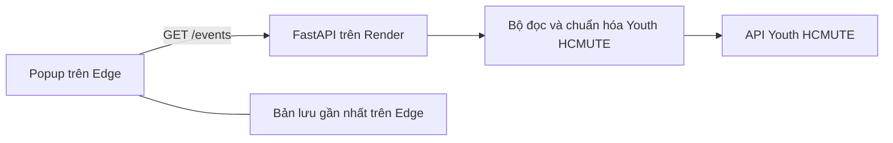

<p align="center">
  
</p>

<h1 align="center">Utelity</h1>

<p align="center">
  Xem sự kiện sắp diễn ra của HCM-UTE và tìm hoạt động còn mở đăng ký ngay trên Microsoft Edge.
</p>

## Giao diện

| Danh sách sự kiện | Khi nguồn dữ liệu tạm thời không phản hồi |
| :---: | :---: |
|  |  |

Ảnh bên trái là popup Utelity trên Edge với sự kiện từ Youth HCMUTE. Ảnh bên phải minh họa trạng thái hiển thị dữ liệu đã lưu khi nguồn tạm thời không phản hồi.

## Utelity làm gì?

- Hiển thị sự kiện đã được Youth HCMUTE duyệt, đang hoạt động và chưa bắt đầu.
- Nhóm sự kiện theo trạng thái đăng ký. Bộ lọc **Đang mở đăng ký** đưa người dùng đến ngay các hoạt động còn có thể đăng ký.
- Hiển thị quyền lợi, ngày diễn ra và link đăng ký, thể lệ hoặc thông báo gốc khi nguồn cung cấp. Sau hạn đăng ký, popup ẩn nút đăng ký.
- Lưu danh sách tải thành công gần nhất trên trình duyệt và ghi rõ khi đang hiển thị dữ liệu cũ.

## Cài thử trên Edge

1. Mở [GitHub Releases](https://github.com/februus268/Utelity-Releases/releases), chọn bản muốn thử, chẳng hạn [Utelity 0.2.1 Beta](https://github.com/februus268/Utelity-Releases/releases/tag/v0.2.1-beta).
2. Trong **Assets**, tải file ZIP Utelity đính kèm (ví dụ `Utelity-0.2.1-beta.zip`) và giải nén.
3. Mở `edge://extensions`, bật **Developer mode** rồi chọn **Load unpacked**.
4. Chọn thư mục vừa giải nén chứa `manifest.json`, rồi mở Utelity từ menu tiện ích.

Popup mặc định gọi [API công khai trên Render](https://utelity.onrender.com/events). Người dùng thử không cần cài Python hay cấu hình Neon. Nếu API trả danh sách rỗng, popup sẽ hiện trạng thái chưa có sự kiện.

## Kiến trúc



Khi mở popup hoặc bấm **Tải lại**, extension lấy danh sách qua Render. Backend đọc Youth HCMUTE và dùng bộ nhớ đệm 30 giây để giảm số lần gọi nguồn. Render có thể phản hồi chậm ở lần đầu sau một thời gian không hoạt động. Popup giữ danh sách lưu trước đó trong lúc chờ.

## Cấu trúc dự án

| Vị trí | Trách nhiệm |
| --- | --- |
| [extension/](extension/) | Popup, kiểu giao diện, manifest, biểu tượng và logic gọi API. |
| [utelity/api.py](utelity/api.py) | FastAPI, phản hồi công khai của `GET /events` và bộ nhớ đệm. |
| [utelity/youth_hcmute.py](utelity/youth_hcmute.py) | Đọc các trang sự kiện, lọc thời điểm bắt đầu và chuẩn hóa dữ liệu. |
| [utelity/event_store.py](utelity/event_store.py) | Công cụ xem trước và nhập sự kiện theo yêu cầu. |
| [database/schema.sql](database/schema.sql) | Schema PostgreSQL từ giai đoạn lưu sự kiện. Luồng hiển thị hiện tại đọc trực tiếp Youth HCMUTE. |
| [tests/](tests/) | Kiểm thử Python và JSON giả lập. |
| [docs/](docs/) | Yêu cầu sản phẩm, danh mục nguồn và ghi chú khảo sát API. |

## Chạy backend trên máy

Các lệnh dưới đây dùng PowerShell tại thư mục gốc repo. Môi trường dự án đã được kiểm thử với Python 3.13.

```powershell
python -m venv .venv
.\.venv\Scripts\python.exe -m pip install -r requirements.txt
.\.venv\Scripts\python.exe -m uvicorn utelity.api:app --reload
```

Mở [API sự kiện](http://127.0.0.1:8000/events) để xem JSON hoặc [Swagger UI](http://127.0.0.1:8000/docs) để gọi thử. Nếu muốn popup gọi bản local, đổi `eventsUrl` trong `extension/popup.js` thành `http://127.0.0.1:8000/events`, khai báo `http://127.0.0.1/*` trong `host_permissions` của manifest và reload extension.

### Kiểm thử và xem trước dữ liệu

```powershell
.\.venv\Scripts\python.exe -m unittest discover -s tests -v
.\.venv\Scripts\python.exe -X utf8 -m utelity.event_store tests/fixtures/youth_hcmute_pages.json --dry-run
```

Lệnh `--dry-run` chuẩn hóa dữ liệu mẫu và cho biết sự kiện nào đủ điều kiện xuất hiện. Lệnh này chạy offline và không ghi vào Neon.

## Phạm vi của bản demo

Danh sách hiện lấy từ [Youth HCMUTE](https://youth.hcmute.edu.vn/). Các kênh khoa và CLB đang được khảo sát trong [danh mục nguồn](docs/product/source-inventory.md).

## Góp ý cho Utelity

Bạn có thể [gửi phản hồi trên GitHub Issues](https://github.com/februus268/Utelity-Releases/issues/new) nếu gặp lỗi, thấy thiếu sự kiện hoặc có ý tưởng giúp Utelity hữu ích hơn cho sinh viên HCM-UTE.

- **Báo lỗi:** ghi phiên bản Utelity và trình duyệt, các bước gặp lỗi, kết quả mong đợi và kết quả thực tế. Đính kèm ảnh chụp màn hình nếu hữu ích.
- **Báo thiếu sự kiện hoặc sai thông tin:** gửi tên sự kiện và link thông báo gốc để mình đối chiếu.
- **Đề xuất tính năng:** mô tả việc bạn đang muốn làm và chỗ Utelity có thể giúp bạn dễ hơn.

Cảm ơn bạn đã dùng thử và giúp mình cải thiện Utelity.
