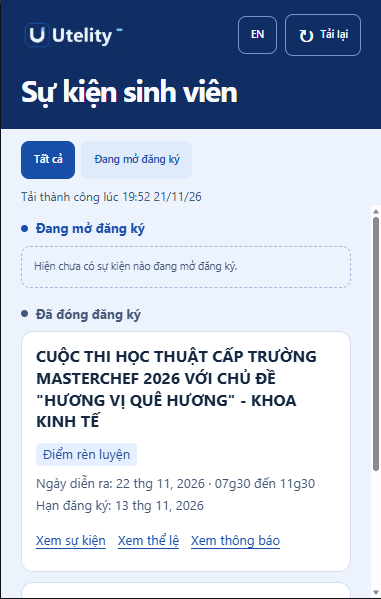
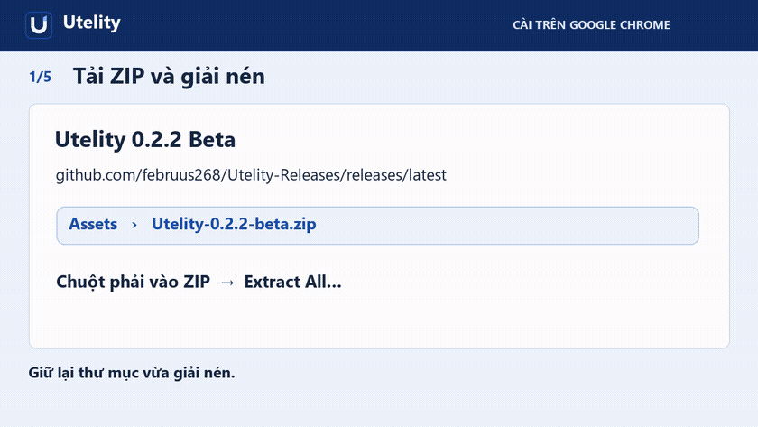

  

<h1 align="center">Utelity</h1>

<strong>Theo dõi sự kiện HCM-UTE ngay từ trình duyệt.</strong>

  Tìm hoạt động sắp diễn ra từ Youth HCMUTE, xem sự kiện nào còn mở đăng ký và truy cập thông báo, thể lệ hay biểu mẫu đăng ký từ một nơi.

  <a href="https://github.com/februus268/Utelity-Releases/releases/latest"><strong>Tải Utelity 0.2.5 Beta</strong></a>
  ·
  <a href="#cài-utelity-beta">Hướng dẫn cài đặt</a>

<table>
  <tr>
    <td align="center">
      
    </td>
    <td align="center">
      
       
      <strong>Cài Utelity trên Chrome</strong>
    </td>
  </tr>
</table>

## Cài Utelity Beta

1. [Tải Utelity 0.2.5 Beta (.zip)](https://github.com/februus268/Utelity-Releases/releases/download/v0.2.5-beta/Utelity-0.2.5-beta.zip) rồi giải nén vào một thư mục bạn có thể giữ lại.
2. Mở trang quản lý tiện ích. Trên Edge, nhập `edge://extensions` vào thanh địa chỉ. Trên Chrome, nhập `chrome://extensions`. Với trình duyệt Chromium khác, mở trang quản lý tiện ích và kiểm tra xem có nút **Load unpacked** hay không.
3. Bật **Developer mode**, chọn **Load unpacked** rồi mở thư mục đã giải nén chứa `manifest.json`.
4. Mở Utelity từ menu **Extensions** trên thanh công cụ. Bạn có thể ghim tiện ích để mở nhanh hơn.

[Xem bản phát hành mới nhất](https://github.com/februus268/Utelity-Releases/releases/latest)

## Sử dụng

- Chọn **Đang mở đăng ký** để tìm những hoạt động bạn còn có thể tham gia.
- Mở **Đăng ký**, **Xem thể lệ** hoặc **Xem thông báo** khi sự kiện có liên kết tương ứng.
- Bấm **Tải lại** để kiểm tra danh sách mới. Nếu Utelity đang hiển thị dữ liệu đã lưu, xem thời điểm tải thành công gần nhất.
- Dùng nút **VI/EN** để đổi ngôn ngữ.
- Ghim Utelity lên thanh công cụ để thấy huy hiệu đỏ báo số sự kiện mới chưa xem.

Bản cài thủ công cần cập nhật thủ công. Khi có bản mới, tải ZIP mới, thay nội dung thư mục đã cài rồi bấm **Reload** trên trang quản lý tiện ích.

## Góp ý

Bạn gặp lỗi, thấy thiếu sự kiện hoặc có ý tưởng mới? [Gửi góp ý cho Utelity](https://github.com/februus268/Utelity-Releases/issues/new). Khi báo lỗi, hãy ghi tên trình duyệt, phiên bản Utelity và các bước gặp lỗi. Nếu thiếu hoặc sai sự kiện, hãy gửi kèm link thông báo gốc.

Cảm ơn bạn đã dùng thử Utelity.